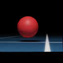
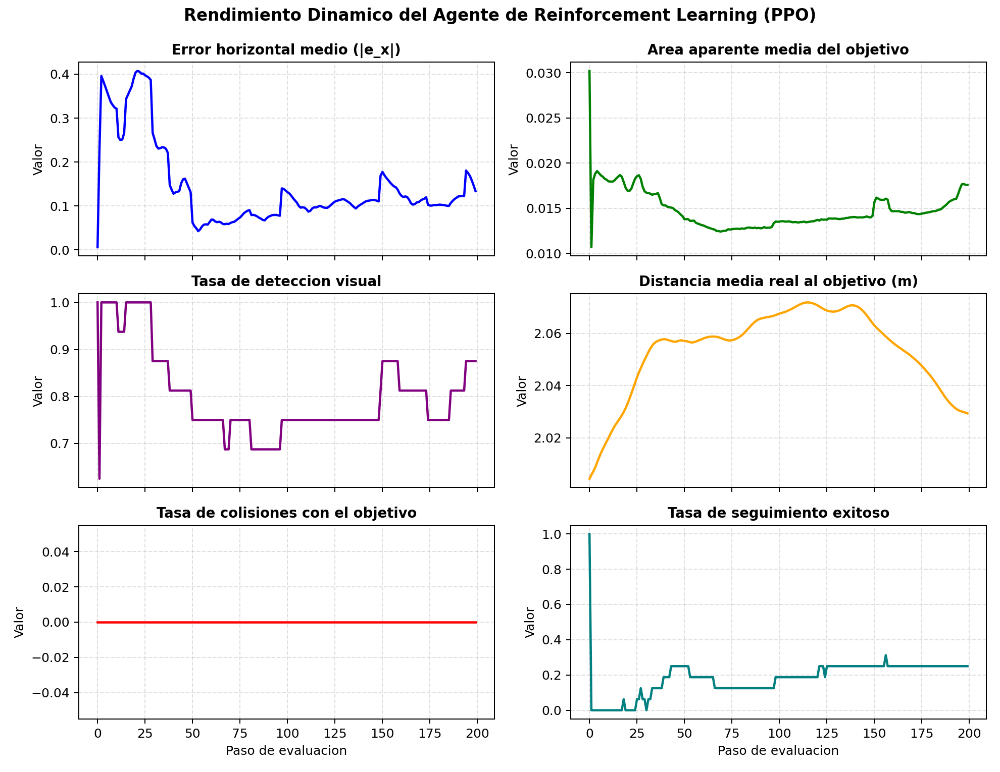
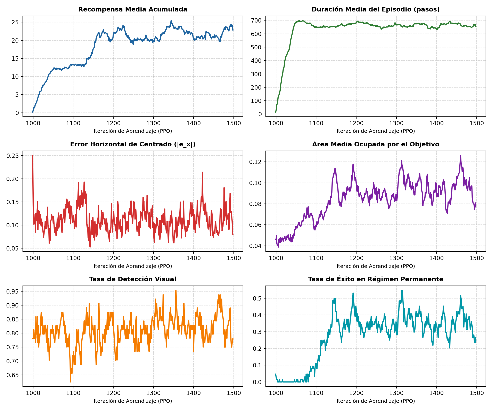

# Seguimiento de Objetivos Móviles con TurtleBot3 mediante Visión Artificial y Reinforcement Learning


-blue)


Proyecto de la asignatura **Modelado y Control de Robots** (*Grado en Informática Industrial y Robótica*, curso 2025/2026).

Este repositorio implementa el modelado, simulación y control de un **TurtleBot3 Burger** capaz de seguir a un objetivo móvil utilizando **únicamente información visual** procedente de una cámara RGB embarcada, entrenado mediante **Reinforcement Learning (PPO)** en entornos vectorizados sobre GPU con **NVIDIA Isaac Sim / Isaac Lab**.

---

## Tecnologías y Herramientas Utilizadas

| Área | Tecnología / Librería | Uso en el proyecto |
| :--- | :--- | :--- |
| **Simulación física y renderizado** | **NVIDIA Isaac Sim & Isaac Lab** (`DirectRLEnv`, PhysX) | Simulación física paralela en GPU, escena interactiva y cámara RGB (`128×128`). |
| **Reinforcement Learning** | **rsl_rl (PPO)** | Entrenamiento *on-policy* Actor-Critic MLP (`[128, 128]`, activación `ELU`, normalización de observaciones). |
| **Visión Artificial** | **PyTorch** / **NumPy** / **Pillow** | Segmentación cromática RGB vectorizada, extracción de centroide normalizado `(cx, cy)` y área aparente. |
| **Control y Cinemática** | **Modelo Cinemático Diferencial** (`TurtleBot3Kinematics`) | Conversión de consignas `(v, ω)` a velocidades angulares de ruedas (`r = 0.033 m`, `L = 0.160 m`). |
| **Modelo Robótico** | **TurtleBot3 Burger** (`USD` + `ROBOTIS-GIT/turtlebot3`) | Descripción física USD para Isaac Sim y paquete oficial ROS 2 como submódulo. |
| **Evaluación y Visualización** | **Matplotlib**, **CSV**, **unittest** | Registro de métricas de seguimiento, generación de gráficas `3×2` y tests unitarios de visión. |

---

## Arquitectura del Proyecto

```text
proyecto_ws/
├── assets/
│   ├── turtlebot3_official/          # Submódulo oficial ROBOTIS (ROS 2 / URDF / meshes)
│   └── turtlebot3_usd/               # Modelo TurtleBot3 Burger en formato USD para Isaac Sim
├── checkpoints/
│   ├── fase1/model_fase1.pt          # Política base entrenada (Fase 1)
│   └── fase1_5/model_fase1_5.pt      # Política de seguimiento cercano multi-escenario (Fase 1.5)
├── contexto/
│   ├── enunciado.txt                 # Enunciado oficial del proyecto
│   └── FichaCompromisoProyecto_Firmado__MCR_25_26_11.pdf
├── results/
│   ├── fase1/                        # Métricas CSV, gráfica y captura de cámara (Fase 1)
│   └── fase1_5/                      # Métricas CSV y gráfica de rendimiento (Fase 1.5)
├── rl/
│   ├── turtlebot3_follow_env.py      # Entorno DirectRLEnv, recompensas, escenarios y visión RGB
│   ├── ppo_cfg.py                    # Hiperparámetros del runner PPO (rsl_rl)
│   ├── train_ppo.py                  # Entrenamiento headless con carga incremental por fases
│   ├── play_ppo.py                   # Visualización en tiempo real en Isaac Sim GUI
│   ├── evaluate.py                   # Evaluación cuantitativa y exportación a CSV
│   └── plot_results.py               # Generación de gráficas de rendimiento
├── scripts/
│   ├── controlador_diferencial.py    # Cinemática directa/inversa (NumPy y PyTorch)
│   └── sensor_camara.py              # Sensor de cámara RGB standalone y extracción de características
└── tests/
    └── test_sensor_camara.py         # Pruebas unitarias de segmentación visual
```

---

## Enfoque Técnico y Fases del Proyecto

### Observación y Control
* **Espacio de observación (4D):** `[detected, center_x, center_y, area_ratio]`, extraído directamente de la cámara RGB (`128×128`) montada sobre `base_link` (`[0.05, 0.0, 0.12] m`). Si el objetivo sale del campo de visión, se conserva el último lado en el que fue visto (`last_side`) para facilitar la búsqueda.
* **Espacio de acciones (2D):** `[v_norm, ω_norm] ∈ [-1, 1]`, transformado a velocidades de rueda izquierda y derecha mediante cinemática diferencial inversa con escalado proporcional para respetar el radio de curvatura.
* **Función de recompensa:** Combina centrado horizontal, mantenimiento de área aparente de referencia (distancia objetivo), continuidad de detección, suavidad de acciones (`action_change`) y penalización por pérdida del objetivo o colisión.

### Fases Implementadas
1. **Fase 1 — Seguimiento base (`--phase 1`):** Objetivo esférico (`r = 0.15 m`) en espacio abierto. Checkpoint consolidado en `checkpoints/fase1/model_fase1.pt`.
2. **Fase 1.5 — Seguimiento cercano y trayectorias complejas (`--phase 1.5`):** Objetivo reducido (`r = 0.08 m`), mayor velocidad del robot (`0.35 m/s`), penalización anti-oscilación y **5 escenarios dinámicos** (`circular`, `slalom`, `stop_and_go`, `acelerones`, `erratico` y `mixto`). Entrenado sobre el checkpoint de la Fase 1 (`checkpoints/fase1_5/model_fase1_5.pt`).

> Para copiar y pegar rápidamente los comandos de cada escenario, consulta [README_COMANDOS.md](README_COMANDOS.md).

---

## Requisitos e Instalación

* **Ubuntu** con **NVIDIA Isaac Sim** e **Isaac Lab** instalados (ej. en `/home/rbriram/IsaacLab`).
* GPU NVIDIA compatible con Isaac Sim.

Clonar el repositorio incluyendo el submódulo oficial de TurtleBot3:
```bash
git clone --recursive https://github.com/rbriz758/Proyecto_Modelado_Control_Robots.git
cd Proyecto_Modelado_Control_Robots
```
*(Si ya lo clonaste sin `--recursive`, ejecuta `git submodule update --init --recursive`).*

---

## Guía de Uso

> Todos los scripts de simulación se ejecutan mediante el lanzador de Python de Isaac Lab (`isaaclab.sh -p`).

### 1. Visualización en Isaac Sim GUI

**Ver un escenario específico de la Fase 1.5:**
```bash
/home/rbriram/IsaacLab/isaaclab.sh -p rl/play_ppo.py --phase 1.5 --scenario mixto
```
Escenarios disponibles para `--scenario`:
* `circular`: Órbita circular de radio fijo a velocidad constante.
* `slalom`: Zig-zag sinusoidal rápido en S (`izquierda ↔ derecha`).
* `stop_and_go`: Avanza `3.0 s`, se detiene por completo `2.5 s` y cambia de rumbo al reanudar.
* `acelerones`: Figura en 8 alternando tramos lentos (`~0.09 m/s`) con esprints (`~0.32 m/s`).
* `erratico`: Quiebros bruscos 2D multifrecuencia con variaciones continuas de velocidad.
* `mixto` *(por defecto)*: Selecciona aleatoriamente entre los 5 escenarios en cada episodio.

**Otras visualizaciones:**
```bash
# Fase 1 (modelo base)
/home/rbriram/IsaacLab/isaaclab.sh -p rl/play_ppo.py --phase 1
```

### 2. Entrenamiento (Headless en GPU)

```bash
# Entrenar o continuar entrenamiento de Fase 1.5
/home/rbriram/IsaacLab/isaaclab.sh -p rl/train_ppo.py \
  --phase 1.5 \
  --num-envs 64 \
  --max-iterations 500

# Continuar desde un checkpoint específico
/home/rbriram/IsaacLab/isaaclab.sh -p rl/train_ppo.py \
  --phase 1.5 \
  --num-envs 64 \
  --max-iterations 800 \
  --checkpoint checkpoints/fase1_5/model_fase1_5.pt
```

### 3. Evaluación y Generación de Gráficas

```bash
# Extraer métricas a CSV
/home/rbriram/IsaacLab/isaaclab.sh -p rl/evaluate.py \
  --phase 1.5 \
  --scenario circular \
  --output results/fase1_5/ppo_circular.csv

# Generar gráfica 3x2 de rendimiento
/home/rbriram/IsaacLab/isaaclab.sh -p rl/plot_results.py \
  results/fase1_5/ppo_circular.csv \
  --output results/fase1_5/rendimiento_circular.png
```

### 4. Tests Unitarios

```bash
/home/rbriram/IsaacLab/isaaclab.sh -p -m unittest discover -s tests -v
```

---

## Resultados

### Captura desde la Cámara RGB Embarcada (Fase 1)


### Rendimiento Dinámico del Agente PPO — Fase 1


### Rendimiento Dinámico del Agente PPO — Fase 1.5

